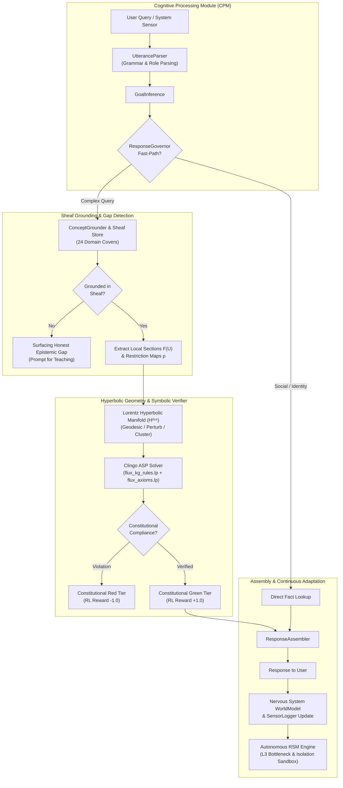

<div align="center">

# FLUX
### Fluid Logic & Knowledge Representation System

[](https://www.python.org/)
[](https://pytorch.org/)
[](https://potassco.org/clingo/)
[](https://github.com/Z3Prover/z3)
[]()

**A Hybrid Neuro-Symbolic Cognitive Architecture Unifying Continuous-Time Liquid Neural Dynamics, Sheaf-Theoretic Knowledge Graphs, and Hyperbolic Causal Manifolds.**

[Key Paradigms](#-core-architectural-pillars) • [System Architecture](#-high-level-system-architecture) • [Measured Metrics](#-empirical-prototype-metrics) • [Honest Scope](#-architectural-boundaries--scope-without-overpromising) • [Quickstart](#-quickstart--installation) • [Deep Dive Docs](#-deep-dive-documentation)

---

</div>

```
   ███████╗██╗     ██╗   ██╗██╗  ██╗
   ██╔════╝██║     ██║   ██║╚██╗██╔╝
   █████╗  ██║     ██║   ██║ ╚███╔╝ 
   ██╔══╝  ██║     ██║   ██║ ██╔██╗ 
   ██║     ███████╗╚██████╔╝██╔╝ ██╗
   ╚═╝     ╚══════╝ ╚═════╝ ╚═╝  ╚═╝
 Fluid Logic & Knowledge Representation System
```

## 🌌 Overview

Modern Artificial Intelligence is dominated by auto-regressive Large Language Models (LLMs) operating under next-token statistical prediction ($P(w_t \mid w_{<t})$). While effective for surface fluency and code syntax matching, this paradigm suffers from inherent structural limitations:

* **Stochastic Hallucination**: Generative sampling from statistical weights lacks an internal model of deterministic truth.
* **Epistemic Opacity**: Standard neural networks cannot distinguish what they know from what they do not know, asserting falsehoods with high confidence.
* **Static Post-Training Rigidity**: Knowledge is locked in frozen parameters; updating requires costly fine-tuning or disconnected vector database retrieval (RAG).
* **Open-Loop Execution**: Generation occurs in a single forward pass without continuous-time feedback loops, persistent self-auditing, or verified safety invariants.

**FLUX** resolves these fundamental challenges by rejecting pure neural mono-cultures. FLUX operates on the principle that **robust cognition requires the seamless interplay of continuous differential dynamics, non-Euclidean geometric manifolds, and deterministic formal logic.**

---

## 🏛️ Core Architectural Pillars

FLUX decouples intelligence into four specialized, mathematically grounded subsystems:

```
                  ┌────────────────────────────────────────┐
                  │      FLUX COGNITIVE ARCHITECTURE       │
                  └───────────────────┬────────────────────┘
                                      │
        ┌───────────────────┬─────────┴─────────┬───────────────────┐
        ▼                   ▼                   ▼                   ▼
┌───────────────┐   ┌───────────────┐   ┌───────────────┐   ┌───────────────┐
│  Continuous   │   │  Hyperbolic   │   │     Sheaf     │   │     Dual      │
│ Liquid Neural │   │ Causal Lorentz│   │  Topological  │   │   Symbolic    │
│ Dynamics (ODE)│   │ Manifold (H²⁵⁶│   │Knowledge Graph│   │ Logic Engines │
└───────┬───────┘   └───────┬───────┘   └───────┬───────┘   └───────┬───────┘
        │                   │                   │                   │
  dx/dt = -x/τ + f    Minkowski R²⁵⁶'¹     Local Sections     Clingo ASP Rules
  RK4 / Euler steps   Geodesic shortest    Restriction Maps   Z3 SMT Solver
  112K params core    Causal propagation   H¹ Gap Detection   Deterministic Sat
```

### 1. Continuous-Time Liquid Neural Dynamics
Unlike standard discrete RNNs or static transformers, FLUX's neural core (`flux/model/liquid_transformer.py`) runs **Liquid Time-Constant (LTC)** cells governed by continuous-time Ordinary Differential Equations:

$$\frac{dh(t)}{dt} = -\left[ \frac{1}{\tau(x, h)} + f(x(t), h(t); \theta) \right] \odot h(t) + f(x(t), h(t); \theta) \odot A + v_{\text{leak}}$$

* **Adaptive Time Constants ($\tau$)**: Dynamically adjusts per evaluation step ($\tau \in [0.01, 10.0]$), preventing numerical explosion while maintaining dynamic state flexibility.
* **Dual Solvers**: 4th-Order Runge-Kutta (RK4) for precision inference; 1st-Order Euler for high-throughput training.
* **Lean & Inspectable**: Entire neural core contains **112,384 parameters**, running microsecond evaluations on standard CPU/consumer hardware.

### 2. Hyperbolic Causal Manifold ($\mathbb{H}^{256} \subset \mathbb{R}^{256, 1}$)
Complex relational hierarchies and conceptual networks suffer severe geometric distortion when forced into flat Euclidean embeddings. FLUX embeds concept spaces on the upper sheet of a 256-dimensional Lorentz hyperboloid in Minkowski space (`flux/manifold/lorentz.py`):

$$\mathbb{H}^d = \left\{ x \in \mathbb{R}^{d+1} : \langle x, x \rangle_L = -\frac{1}{\kappa}, \; x_0 > 0 \right\}, \quad \langle x, y \rangle_L = -x_0 y_0 + \sum_{i=1}^d x_i y_i$$

* **Geodesic Path Tracing (`GEODESIC`)**: Deductive reasoning is formulated as tracing Riemannian shortest paths $\int \sqrt{g_{ij} \dot{v}^i \dot{v}^j} dt$; intermediate points form the step-by-step reasoning chain.
* **Causal Perturbation (`PERTURB`)**: Directional gradient flow $\nabla_d \mathcal{M}$ simulates cascading counterfactual consequences.
* **Topological Gap Discovery (`GAP`)**: Density differentials between domain clusters identify missing concepts for hypothesis generation.

### 3. Sheaf-Theoretic Multi-Domain Knowledge Topology
The knowledge base (`flux/kg/sheaf.py`) is structured as a **Mathematical Sheaf over a Topological Graph**:
* **Local Sections $\mathcal{F}(U)$**: Concepts are preserved inside domain-specific contexts (e.g., *entropy* in Thermodynamics vs. *entropy* in Information Theory), resolving polysemy without semantic collisions.
* **Restriction Maps ($\rho_{U, V}$)**: Formal relational morphisms (`ANALOGOUS_TO`, `GENERALIZES`) translate concepts across domain boundaries.
* **Epistemic Gap Discovery as Cohomology ($H^1$)**: If local sections fail to glue into a globally consistent section $\mathcal{F}(X)$, FLUX detects an $H^1$ cohomological obstruction. Instead of hallucinating, it honest reports:
  > *"I extracted entity X from your query, but it does not ground to any concept in my knowledge graph. This is a genuine epistemic gap."*

### 4. Deterministic Symbolic Dualism
Continuous embeddings are paired with twin symbolic engines (`flux/reasoning/`):
* **Answer Set Programming (Clingo ASP)**: Non-monotonic logic rules (`flux_kg_rules.lp`, `flux_axioms.lp`) deterministically evaluate multi-hop path reachability, cyclic contradictions, and type bounds.
* **Satisfiability Modulo Theories (Z3 SMT)**: Interface for arithmetic invariants and formal boundary constraint verification.

---

## 🔄 High-Level System Architecture



---

## 📊 Empirical Prototype Metrics

The following empirical parameters reflect the live, measured prototype in this repository:

| Metric / Parameter | Live Measured Value | Verification Module |
| :--- | :--- | :--- |
| **Total Knowledge Graph Concepts** | **1,007 nodes** (108 seed nodes, 899 learned nodes) | `flux.kg.store.KGStore` |
| **Verified Relational Edges** | **2,159 edges** | `flux.kg.store.KGStore` |
| **Grounded Lorentz Hyperbolic Vectors** | **845 concept points** in $\mathbb{H}^{256}$ | `logs/flux_manifold.pt` |
| **Knowledge Domains Covered** | **24 domains** (Logic, Physics, Topology, etc.) | `FLUX_PRIMITIVES.md` |
| **Constitutional Logic Primitives** | **88 primitives** across Layers 0–4 | `validate_primitives.py` |
| **Teaching Corpus Blocks** | **570 validated blocks** | `validate_primitives.py` |
| **Evaluation Benchmark Blocks** | **60 formal benchmark blocks** | `validate_primitives.py` |
| **Neural Core Parameter Count** | **112,384 parameters** | `flux.model.liquid_transformer` |
| **Bootstrap Verification Time** | **22 ms** (Cold start integrity verification) | `flux.boot` |
| **Constitutional Invariant Pass Rate** | **100% Axiom Compliance** | `flux.reasoning.clingo_bridge` |

---

## ⚖️ Architectural Boundaries & Scope (Without Overpromising)

In the interest of scientific rigor and engineering honesty, we explicitly articulate the capabilities, design trade-offs, and current boundaries of FLUX v0.8:

### Comparison Matrix

| Dimension / Feature | Standard Auto-Regressive LLM | RAG (Vector DB + LLM) | FLUX Cognitive Architecture |
| :--- | :--- | :--- | :--- |
| **Primary Mechanism** | Statistical token sampling | Chunk retrieval + Prompt injection | Hybrid Neuro-Symbolic + Causal Manifold |
| **Logical Guarantees** | None (Probabilistic) | None (Inherits LLM limits) | **Deterministic** (Clingo ASP rules & axioms) |
| **Temporal Dynamics** | Static discrete forward steps | Static discrete forward steps | **Continuous-Time ODEs** (Liquid LTC cell) |
| **Epistemic Self-Awareness** | Poor (Prone to hallucination) | Moderate (Source citation) | **Exact** (Sheaf $H^1$ Cohomology Gap Detection) |
| **Knowledge Topology** | Unstructured weights | Unstructured text snippets | **Sheaf Topology + Hyperbolic Manifold** |
| **Autonomous Operation** | Single-pass request/response | Single-pass request/response | **Continuous Self-Inquiry & Idle Learning** |
| **Safety Governance** | Soft RLHF alignment | Prompt filters / guardrails | **Cryptographic Constitutional Invariants** |

### Explicit Limitations & Scope
* **Curated Domain Focus**: FLUX is engineered for deep conceptual reasoning in STEM and formal systems (formal logic, category theory, abstract algebra, physics, cryptography). It is not an ungrounded pop-culture conversational bot.
* **Solver Scale Trade-offs**: Clingo ASP guarantees exact logical consistency, but general ASP solving is NP-complete. Sheaf domain localization keeps reasoning fast across its 24 domains, but multi-million-node graphs represent an active research frontier.
* **Stage 5 Formal Spec Generation**: The `z3_bridge.py` interface is established; end-to-end automated formal SMT specification synthesis from unformatted raw natural language is under active development.
* **No Cloud Dependency**: FLUX is built in pure PyTorch and standard C-extension libraries (`clingo`, `z3-solver`). It runs entirely on local consumer hardware without cloud API dependencies.

---

## 🚀 Quickstart & Installation

### 1. Prerequisites
* **Python >= 3.10** (Recommended: Python 3.11 or 3.12)
* Linux, macOS, or Windows WSL2

### 2. Clone & Setup Virtual Environment
```bash
git clone https://github.com/akhil-k-dubey/Flux-.git
cd Flux-

python -m venv venv
source venv/bin/activate  # On Windows: .\venv\Scripts\activate
pip install -r requirements.txt
```

### 3. Verify System Integrity & Bootstrap
Run the cryptographic constitutional integrity verification:
```bash
python -m flux.boot --verify-only
```
*Expected output:*
```
================================================================
  FLUX BOOTSTRAP REPORT
================================================================
  [PASS] constitution_exists: FLUX_PRIMITIVES.md
  [PASS] integrity_hash: SHA256 verified — 3202a17398ecac96...
  [PASS] primitives: 88 primitives (min 80)
  [PASS] concepts: 570 concepts (min 500)
  [PASS] edges: 3709 edges (min 3000)
  [PASS] grammar_blocks: 10 grammar blocks
  [PASS] benchmarks: 60 benchmarks
  Readiness Score: 1.00 / 1.00 (Boot Time: 22 ms)
  STATUS: OPERATIONAL
================================================================
```

### 4. Interactive Python Usage
```python
from flux.interface import FluxInterface

flux = FluxInterface()

# Direct concept query (Grounded via Sheaf & Manifold)
print(flux.ask("what is entropy?"))

# Relational connection across domains
print(flux.ask("how does entropy connect to information theory?"))

# Epistemic gap detection (Honest reporting on unknown entities)
print(flux.ask("what don't you know about quantum gravity?"))
```

### 5. Running the Autonomous Self-Inquiry Loop
FLUX can operate continuously in the background, conducting self-inquiry, measuring sensory drift, and proposing architectural improvements:
```bash
python flux_runner.py --cycle 30
```

---

## 📚 Deep-Dive Documentation

For detailed mathematical proofs, parameter derivations, data schemas, and component interfaces, see:

* [**`ARCHITECTURE.md`**](./ARCHITECTURE.md): Full technical specification of the seven system layers, Lorentz manifold formulas, Sheaf definitions, and the Autonomous Recursive Self-Modification (RSM) pipeline.
* [**`FLUX_PRIMITIVES.md`**](./FLUX_PRIMITIVES.md): The constitutional core primitives, grammar blocks, initial teaching corpus, and evaluation benchmarks.
* [**`FLUX_Academic_Research_Paper.pdf`**](./FLUX_Academic_Research_Paper.pdf): Pre-print whitepaper: *"FLUX: A Hybrid Neuro-Symbolic Cognitive Architecture Unifying Continuous-Time Liquid Neural Dynamics, Sheaf-Theoretic Knowledge Graphs, and Causal Manifold Geodesics"* (Sept 2026).

---

## 📂 Project Directory Structure

```
FLUX/
├── ARCHITECTURE.md                  # Detailed architectural specification
├── README.md                        # Project documentation (this file)
├── FLUX_PRIMITIVES.md               # Constitutional grammar & primitives
├── FLUX_Academic_Research_Paper.pdf # Academic whitepaper
├── requirements.txt                 # Dependencies: torch, clingo, z3-solver, numpy
├── validate_primitives.py           # Primitive syntax and verification script
├── flux_runner.py                   # Autonomous background runner
├── flux_axioms.lp                   # Clingo ASP safety axioms
├── flux_kg_rules.lp                 # Clingo ASP graph deduction rules
├── checkpoints/                     # Model weights & configuration files
│   ├── flux_architecture.json       # Network hyperparameters
│   ├── flux_grounded_best.pt        # Grounded Liquid Transformer checkpoint
│   └── language_encoder.pt          # Language projection head weights
├── logs/                            # Live system telemetry & knowledge commits
│   ├── flux_kg_live.jsonl           # Live Knowledge Graph store (1,007 nodes)
│   ├── flux_manifold.pt             # Pre-computed Lorentz manifold embeddings (845 concepts)
│   └── world_model.json             # Dynamic world and operator state
└── flux/                            # Core Python architecture
    ├── boot.py                      # Cryptographic boot orchestrator
    ├── model/                       # Liquid Transformer, LiquidCell ODE, FieldEncoder
    ├── kg/                          # Sheaf engine, KGStore, consistency verifier
    ├── manifold/                    # Lorentz geometry, causal manifold & propagators
    ├── reasoning/                   # Clingo ASP & Z3 SMT bridges
    ├── cpm/                         # Utterance parser, goal inference & response governor
    ├── operators/                   # Constitutional layer, manifold executor & vector router
    ├── nervous_system/              # WorldModel, perception loop & interaction tracking
    ├── sensors/                     # System telemetry, self-monitor & consequence writer
    ├── rsm/                         # Recursive Self-Modification (L3A/B/C)
    ├── language/                    # Dual encoder, intent parser & response assembly
    └── interface/                   # FluxInterface unified entry point
```

---

## 📜 Citation & Research Attribution

If you use FLUX in your research or wish to reference the cognitive architecture:

```bibtex
@article{dubey2026flux,
  title={FLUX: A Hybrid Neuro-Symbolic Cognitive Architecture Unifying Continuous-Time Liquid Neural Dynamics, Sheaf-Theoretic Knowledge Graphs, and Causal Manifold Geodesics},
  author={Dubey, Akhil K.},
  journal={Institutional Pre-Print},
  year={2026},
  version={0.8}
}
```

---

<div align="center">
  <sub>Developed by Akhil K. Dubey. Built for inspectable, grounded, and mathematically verifiable machine intelligence.</sub>
</div>
